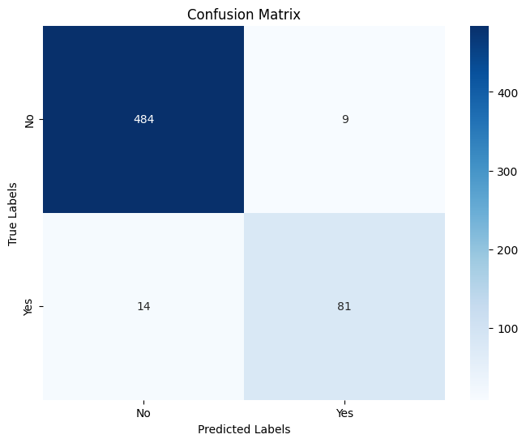
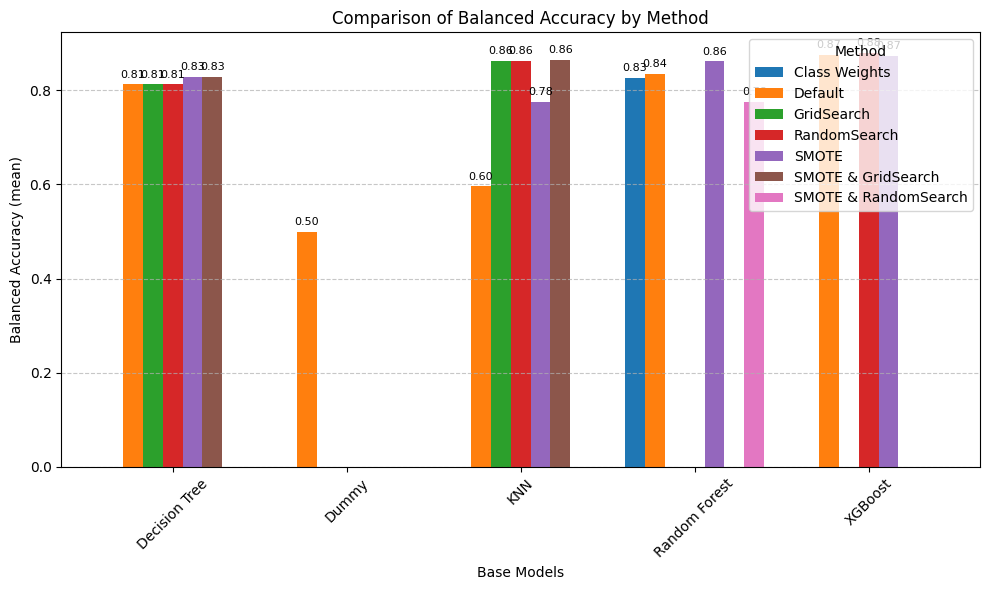
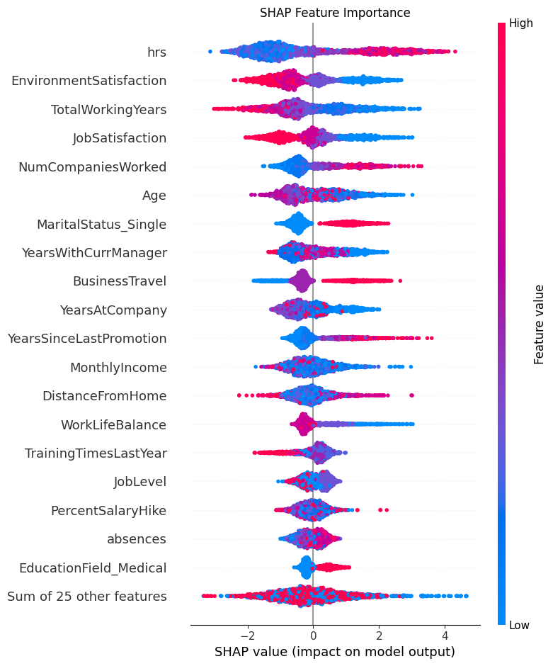

# Employee Attrition Prediction with Imbalanced Classification

Predicting which employees will leave from HR, survey and working-hours data: a tuned XGBoost model reaches 0.92 balanced accuracy on a held-out test set where only 16.12% of employees leave.



## The problem
Attrition is costly: every departure means recruiting, onboarding and lost productivity. Given 2,940 employee records (demographics, job role, satisfaction surveys, overtime hours, absences, income), the goal is a classifier that flags likely leavers and explains which factors drive attrition. Only 16.12% of the records are leavers, so plain accuracy is misleading and models are compared on balanced accuracy.

## Approach
- **EDA**: 2,940 rows × 31 columns, 78 missing values in 5 survey/history columns, 3 constant columns and 1 ID column dropped, class ratio No 0.838776 / Yes 0.161224.
- **Evaluation design**: stratified 80/20 train-test split (2,352 / 588 rows) for the outer estimate of future performance; stratified 5-fold cross-validation on the training set for model selection.
- **Preprocessing pipeline** (`ColumnTransformer`): mean imputation and standard scaling for numeric features, most-frequent imputation for categorical ones, ordinal encoding for ordered categories, one-hot encoding for nominal ones.
- **Baselines and basic models**: dummy classifier, decision tree, k-nearest neighbours.
- **Hyperparameter optimization**: GridSearchCV, RandomizedSearchCV and Optuna, compared on score and cost.
- **Class imbalance**: SMOTE (in an `imblearn` pipeline so it only touches training folds) and class weights, alone and combined with HPO.
- **Ensembles**: Random Forest and XGBoost with default settings, with SMOTE or class weights, and with RandomizedSearchCV.
- **Final model**: XGBoost + RandomizedSearchCV, evaluated once on the test set, retrained on all data, saved with `joblib` and applied to a 1,470-row competition set.
- **Interpretability**: XGBoost feature importance and a SHAP beeswarm plot.

## Key results
Mean 5-fold cross-validated balanced accuracy on the training set:

| Model | Balanced accuracy |
|---|---|
| Dummy | 0.5000 +/- 0.0000 |
| KNN (default) | 0.5959 +/- 0.0087 |
| Decision tree (default) | 0.8128 +/- 0.0134 |
| Decision tree + SMOTE | 0.8286 +/- 0.0226 |
| Random Forest (default) | 0.8351 +/- 0.0173 |
| Random Forest + SMOTE | 0.8613 +/- 0.0162 |
| KNN + SMOTE & GridSearch | 0.8640 +/- 0.0099 |
| XGBoost + SMOTE | 0.8739 +/- 0.0042 |
| XGBoost (default) | 0.8749 +/- 0.0184 |
| **XGBoost + RandomSearch** | **0.8792 +/- 0.0107** |

Selected model on the held-out test set (588 employees): **balanced accuracy 0.92, accuracy 0.96**; confusion matrix [[484, 9], [14, 81]] (rows: true No / Yes). Retrained on all available data, its best cross-validation score is 0.9235889969260402.



SHAP analysis: more overtime hours (`hrs`) and more previous employers raise attrition risk; higher environment and job satisfaction, more total working years and older age lower it.



## Stack
Python: pandas, NumPy, Matplotlib, seaborn, scikit-learn, imbalanced-learn, XGBoost, Optuna, SHAP, joblib.

## Run it
```
pip install pandas numpy matplotlib seaborn scikit-learn imbalanced-learn xgboost optuna shap joblib
jupyter notebook Employee-Attrition-Prediction-ML.ipynb
```
The two CSV files must sit next to the notebook (they are included). The rendered `Employee-Attrition-Prediction-ML.html` shows all outputs without running anything.

The stored outputs were produced with a different random seed, which was removed because it was a personal identifier. With the current seed (`STUDENT_ID = 123456789`), a rerun gives slightly different splits and scores from the ones shown.

## Repository structure
```
Employee-Attrition-Prediction-ML.ipynb        full analysis with outputs
Employee-Attrition-Prediction-ML.html         rendered notebook
attrition_availabledata_10.csv                labelled data (2,940 rows)
attrition_competition_10.csv                  unlabelled competition data (1,470 rows)
competition_predictions.csv                   final model predictions for the competition data
final_model_xgboost_randomsearch.joblib       trained final pipeline (binary, ~670 KB; not needed to read the project)
figures/                                      key plots extracted from the notebook outputs
LICENSE                                       MIT (code)
```

## Context and authorship
- Built as part of the MSc in Big Data Analytics, Universidad Carlos III de Madrid (2024-2025).
- Team project with Rodrigo Castro Freibott.
- Code is released under the MIT License. The datasets were provided for coursework and are included for reproducibility only; their licence is not covered by the MIT License.

## Author
**Juan del Mazo Vázquez** — [Website](https://juandelmazovazquez.vercel.app) · [LinkedIn](https://www.linkedin.com/in/juan-del-mazo-7500a7276) · [GitHub](https://github.com/JuandelMazoVazquez)

<details>
<summary>Resumen en español</summary>

Clasificador de rotación de empleados sobre 2.940 registros de RR. HH., con solo un 16,12 % de bajas. Se comparan árbol de decisión, KNN, Random Forest y XGBoost con GridSearch, RandomizedSearch y Optuna, y se trata el desbalanceo con SMOTE y pesos de clase, evaluando con balanced accuracy en validación cruzada estratificada de 5 particiones. El modelo final, XGBoost con RandomizedSearch (0,8792 en validación cruzada), obtiene 0,92 de balanced accuracy y 0,96 de accuracy en el conjunto de test. SHAP señala las horas extra, la satisfacción con el entorno y el puesto, y la experiencia como factores principales.

</details>
